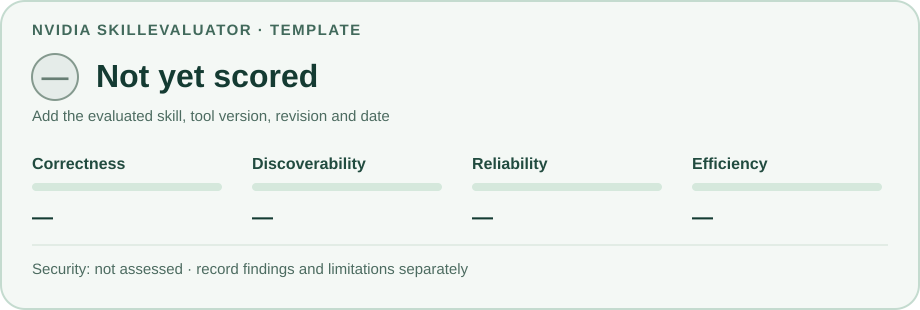

# create-skill

Turn a workflow into a focused [Agent Skill](https://agentskills.io), with its own repository, a clear README and a review before publication. It works with Claude Code, Codex, Cursor and other agents that load skills.

## How it works

| Step | What happens |
| --- | --- |
| **Write** | Define when the skill applies and the instructions the agent needs. |
| **Document and test** | Prepare a concise README and meaningful offline tests for scripts. |
| **Evaluate** | Record available checks and limitations against the actual skill revision. |
| **Review** | Show the content to the user before publishing. |
| **Publish and install** | With the user's go-ahead, publish the repository and install the skill. |

The installable skill and templates live under `skills/create-skill/`; project documentation and tests belong outside the skill folder.

## Quick start

```bash
npx skills add illescasDaniel/create-skill
```

Ask your agent to create a skill, describe the workflow and review the result before publishing.

<details>
<summary>Installation options</summary>

For non-interactive installation, use `npx skills add illescasDaniel/create-skill -a claude-code -a codex -y`; add `-g` for a global install. Or copy `skills/create-skill` into the relevant skills directory:

| Agent | Project | Global |
| --- | --- | --- |
| Claude Code | `.claude/skills/create-skill/` | `~/.claude/skills/create-skill/` |
| Codex | `.agents/skills/create-skill/` | `~/.agents/skills/create-skill/` |
| Cursor | `.cursor/skills/create-skill/` | `~/.cursor/skills/create-skill/` |

</details>

## Evaluation and tests



The skill guides authors to test scripts offline, verify scratch installations and document applicable NVIDIA SkillEvaluator checks, including security findings and limitations. **This is an unscored template:** create-skill itself has not been evaluated here. Generated projects should show only measured results for the exact artifact evaluated.

## Contributing

Issues and pull requests are welcome. Keep the skill concise: each instruction should earn its place.

## License

[MIT](LICENSE).
